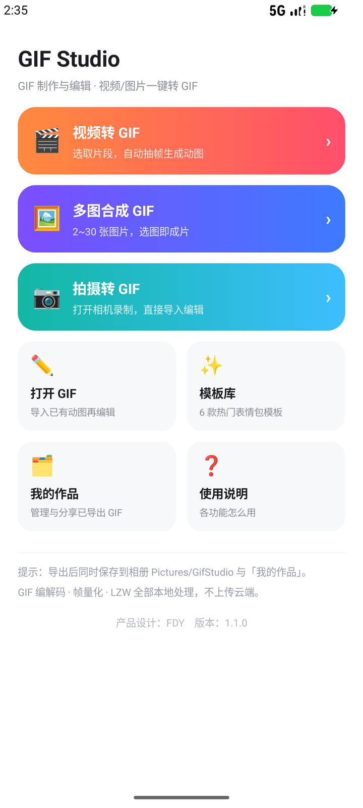
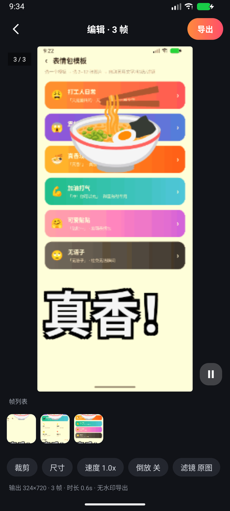
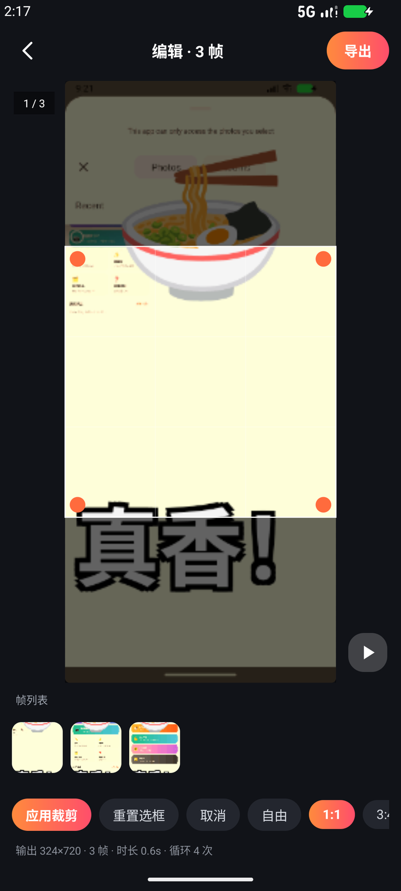
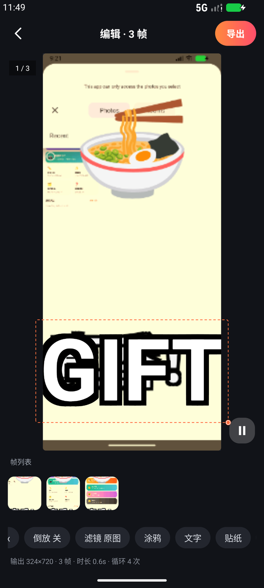
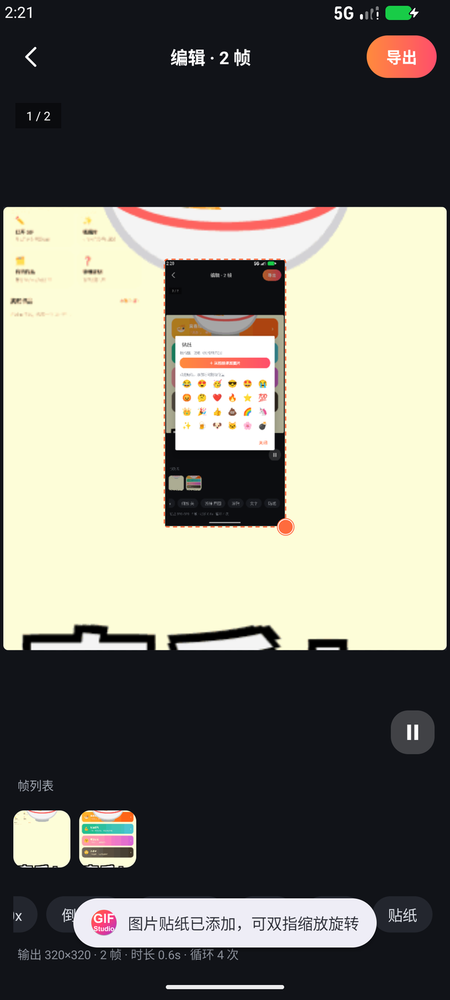
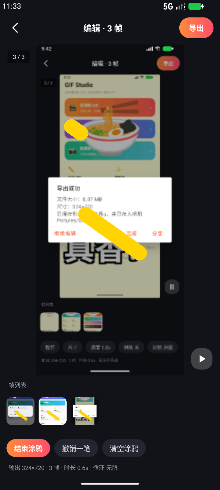
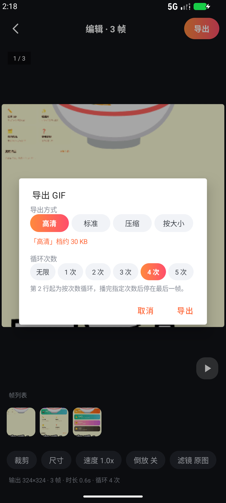
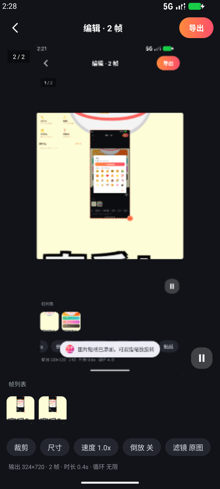

# GIF Studio · 安卓 GIF 编辑器

> 依据《GIF编辑器小程序开发需求文档》改造为原生 Android 应用：视频/图片一键转 GIF，手机上完成裁剪、
> 文字贴纸（双指捏合缩放与旋转）、涂鸦、滤镜、按文件体积导出与循环次数设置。**全程离线、无水印、无广告**，
> GIF 编解码全部自研（没有引入任何第三方 GIF 库）。

- 版本：**1.1.0**（versionCode 2）
- 包名：`com.gifstudio.editor`｜应用名：`GIF Studio`
- 技术栈：Kotlin + AndroidX（AppCompat / Material），`minSdk 26` / `targetSdk 36` / `compileSdk 36`，JVM 17
- 体积：release APK 约 4.2 MB
- 官网：https://fangdanyu.github.io/gif-studio/ ｜ 下载：见 [Releases](https://github.com/fangdanyu/gif-studio/releases)

## 功能一览

| 模块 | 功能 |
|---|---|
| 制作 | 视频转 GIF（8/10/12/15fps，320/480/640 宽）· 多图合成（2~30 张，选图即成片）· 拍摄转 GIF · 打开已有 GIF |
| 编辑 | 拖拽框选裁剪 + **固定比例 1:1 / 3:4 / 4:3 / 16:9 / 9:16**（四角控点内缩） |
| 编辑 | 文字（8 色 / 描边·纯色·底色块）· 24 款 emoji 贴纸 · **相册自定义图片贴纸** |
| 编辑 | 单指拖动、手柄缩放、**双指捏合缩放 + 旋转**（文字 / emoji / 图片贴纸通用） |
| 编辑 | 涂鸦（8 色 + 粗细滑杆，撤销 / 清空）· 9 种滤镜 · 速度 0.5x~3x · 正放倒放 · 自定义输出宽度 |
| 编辑 | 帧多选删除（至少保留 1 帧）· 帧时长统一调整 · 单击预览某帧 |
| 导出 | 画质三档（高清/标准/压缩），点选即时显示**预估文件大小** |
| 导出 | **按目标体积导出** 0.5MB~10MB 滑杆（12 档参数梯度逼近）· **循环次数** 无限 + 1~5 次 |
| 导出 | 存相册 `Pictures/GifStudio` + App 内「我的作品」，一键分享、可再编辑 |
| 交互 | 图层提示只在首次选中弹一次；未导出就退出会提示「还没有导出」，可导出 / 放弃 / 继续编辑 |

未纳入本版本（需求文档 P2/P3）：录屏转 GIF、GIF 转视频、GIF 拆帧、逐帧单独编辑、AI 抠图、云端素材库、分享链接、会员体系。

## 界面截图

| 首页 | 编辑页 | 固定比例裁剪 | 双指缩放旋转 |
|---|---|---|---|
|  |  |  |  |

| 相册图片贴纸 | 涂鸦 | 导出预估体积 | 多图合成 |
|---|---|---|---|
|  |  |  |  |

更多截图见 [`docs/screens/`](docs/screens)，宣传海报与官网用图见 [`docs/assets/`](docs/assets)。

## 下载与安装

1. 打开 [Releases](https://github.com/fangdanyu/gif-studio/releases) 下载 `GifStudio-1.1.0-release.apk`（推荐）或 debug 版；
2. 手机允许"安装未知来源应用"后安装；
3. Android 8.0（API 26）及以上可用，覆盖安装不会丢「我的作品」。

> 仓库不包含签名证书（`keystore/` 已在 `.gitignore` 中排除），发布包使用维护者本地证书签名。
> 自己构建 release 时请提供你自己的 keystore，见下文「自己构建」。

## 使用方法

1. **选入口**：视频转 GIF / 多图合成 GIF / 拍摄转 GIF / 打开 GIF / 模板库 / 我的作品。
2. **编辑**：底部工具条横向滑动 → 裁剪、尺寸、速度、倒放、滤镜、涂鸦、文字、贴纸。
   - 裁剪：点「裁剪」→ 选比例（自由 / 1:1 / 3:4 / 4:3 / 16:9 / 9:16）→ 拖四角或框内拖动 → 「应用裁剪」。
   - 文字/贴纸：添加后先单指点选（出现橙色虚线框），再单指拖动、拖右下角圆点缩放，或**双指捏合缩放 + 旋转**。
   - 相册贴纸：贴纸弹窗顶部「＋ 从相册添加图片」。
3. **导出**：右上「导出」→ 选画质（会即时显示"约 XX KB"）或「按大小」拖滑杆 → 选循环次数 → 导出。
4. **结果**：自动存相册 `Pictures/GifStudio/` 与「我的作品」，可分享或再编辑。

## 自己构建

环境：JDK 17+（Android Studio 自带 JBR 可用）、Android SDK Platform 36、Build-Tools 36.1.0。

```powershell
# 1) 指向本机 SDK（或删掉让 Studio 自动生成）
#    local.properties: sdk.dir=C:/Users/<you>/AppData/Local/Android/Sdk

# 2) 构建 debug
.\gradlew.bat :app:assembleDebug

# 3) 构建签名 release（需自备 keystore，二选一：写进 local.properties 或设环境变量）
#    local.properties:
#      gifstudio.storeFile=../keystore/your.jks
#      gifstudio.storePassword=******
#      gifstudio.keyAlias=your-alias
#      gifstudio.keyPassword=******
#    或环境变量：GIFSTUDIO_STORE_FILE / GIFSTUDIO_STORE_PASSWORD / GIFSTUDIO_KEY_ALIAS / GIFSTUDIO_KEY_PASSWORD
.\gradlew.bat :app:assembleRelease

# 4) 单元测试（11 例）
.\gradlew.bat :app:testDebugUnitTest

# 5) 设备内手势回归测试（需连接真机/模拟器）：双指捏合旋转、固定比例裁剪
.\gradlew.bat :app:connectedDebugAndroidTest --console=plain --max-workers=1
```

在国内网络下，`settings.gradle.kts` 已配置阿里云 Maven 镜像、wrapper 指向华为云镜像；若直连官方源更快可自行调整。

## 目录结构

```
app/src/main/java/com/gifstudio/editor/
├── MainActivity.kt          首页与各入口流程（视频/多图/拍摄/模板）
├── EditorActivity.kt        编辑页（裁剪、图层、滤镜、导出、退出保护）
├── GalleryActivity.kt       我的作品
├── TemplateActivity.kt      表情包模板
├── gif/                     GifEncoder / GifDecoder / GifQuantizer（自研）
├── edit/ProjectRenderer.kt  非破坏渲染管线（裁剪/滤镜/图层/涂鸦）
├── media/                   视频抽帧、图片导入、导出引擎、GifStore
├── model/GifProject.kt      编辑数据模型
├── view/GifPreviewView.kt   播放、图层拖拽缩放旋转、拖框裁剪、涂鸦
└── ui/Ui.kt                 统一 UI 构件

app/src/test/                编解码单测、诊断用例、性能基准（11 例）
app/src/androidTest/         设备内手势回归测试
docs/                        官网 index.html + 截图 + 海报 + 测试记录 + 技术方案 + 需求原文
tools/                       图标生成、站点素材生成脚本（Python + Pillow）
```

## 技术要点

1. **自研 GIF 编码**：中位切分量化到 ≤256 色 + 15bit 颜色缓存映射 + 标准 LZW，支持局部调色板、1bit 透明、循环次数、逐帧延时。
2. **自研 GIF 解码**：完整解析 GIF87a/89a，支持全局/局部色表、隔行扫描、GCE 透明、处置方式 0~3、按倍数降采样解码。
3. **非破坏编辑**：原始帧只读，裁剪/缩放/滤镜/图层都在渲染时合成，预览与导出共用同一套绘制代码（所见即所得）。
4. **拖框裁剪 + 比例锁定**：归一化裁剪矩形可反复叠加精修；固定比例时按"宽主导、高不足改高主导"补齐并 clamp。
5. **双指变换**：记录双指间距/角度/中点，按间距比缩放、角度差旋转、中点位移平移；命中测试把触点反向旋转到图层本地坐标。
6. **按体积导出**：12 档参数梯度（720/256 色 → 180/24 色 + 抽帧）逐档编码，达标即返回，全部超标时给出真实最小体积。
7. **导出体积预估**：导出弹窗先真编码一次并缓存，切画质/切循环重算，点导出直接复用缓存。
8. **内存控制**：导入长边 ≤720、合成 ≤30 张、单项目 ≤64 帧、预览 420 长边、导出按档位限尺寸与抽帧。

> 编解码的正确性不是"自己解自己能过"就算过：单测同时用 Python/Pillow 生成的 GIF 做交叉校验，
> 并反过来用 Pillow 解本项目编码的文件（3 帧逐像素 0 差异、256 色渐变平均通道误差 3）。
> 详细数据与设备截图见 [`docs/测试记录.md`](docs/测试记录.md)。

## 开源与致谢

GIF 编解码全部自研，**没有引入任何第三方 GIF 库**。实际使用的依赖与工具：

- **运行时**：Kotlin 2.1.21、AndroidX Core KTX 1.13.1、AppCompat 1.7.0、Material Components 1.12.0、Activity KTX 1.9.3、ExifInterface 1.3.7（均为 Apache-2.0）
- **测试**：JUnit 4.13.2（EPL-1.0）、AndroidX Test Runner/Core/Ext-JUnit（Apache-2.0）
- **构建**：Gradle 8.14.3、AGP 8.13.2、Android SDK Platform 36 / Build-Tools 36.1.0
- **脚本**：Python 3 + Pillow（仅 `tools/` 下生成图标与站点素材）

完整清单（含用途、许可与传递依赖说明）见 [**THIRD_PARTY.md**](THIRD_PARTY.md)。

## 许可

代码以 [MIT](LICENSE) 协议开源。APK 可自由分发，请保留署名「产品设计：FDY」。

---

产品设计：FDY　版本：1.1.0
